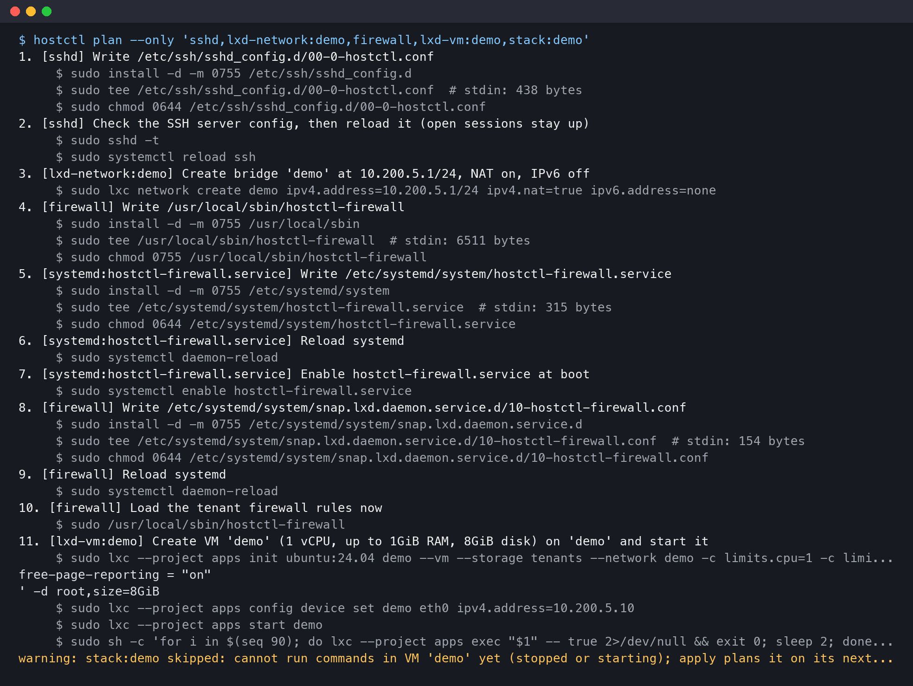

# hearth

**A self-hosted app platform as code for one Linux server.** Describe the server and its apps in
TOML; `hostctl` puts each app environment in its own LXD virtual machine, publishes it through a
Cloudflare Tunnel, and keeps the whole machine matching the config. Every change is shown as an
exact plan of commands before anything runs.



<sub>Real output of `hostctl plan` for the example config, planned against an empty server
simulated by the test suite.</sub>

## What it replaces

Hosting a handful of apps on your own hardware usually ends up as one of:

- **A hand-configured server**: commands typed over SSH, notes in a text file, and no way to tell
  what drifted since.
- **A self-hosted PaaS** such as Coolify, Dokploy or CapRover: a web panel and a database of state,
  with every app's containers sharing one Docker host and one kernel.
- **A managed platform** such as Heroku, Render or Fly.io: no server to run, but paid per app and
  not your hardware.

hearth sits between them. Like Terraform or Ansible, the desired state lives in version control and
is applied idempotently; unlike them, it is a small, opinionated tool for exactly one job (several
isolated apps on one box), with checks that prove the isolation holds.

## Features

- **One VM per app environment.** Each app gets its own LXD VM on its own bridge, in a restricted
  LXD project that refuses host folders, privileged mode and raw QEMU options.
- **Isolation you can test.** A host firewall blocks every VM from the local network, private
  ranges and the other VMs; `hostctl verify` proves it from inside each VM, along with "nothing
  listens beyond loopback except the ports you listed" and "these public URLs answer".
- **Public access without open ports.** Cloudflare Tunnels carry traffic in; hostctl creates them,
  sets their routes and DNS, hides paths at the edge (API docs answer 404), adds redirects, turns on
  DNSSEC and keeps SPF/DMARC records for domains that send no mail.
- **Deploys from git.** A stack ships the committed tree of each source checkout (HEAD, or a branch
  such as `prod`) into its VM and runs its Docker Compose file. Uncommitted changes never ship.
- **Releases without downtime.** Rolling services get a healthy new container before the old one
  stops; one-shot jobs (migrations) run in between; a failed healthcheck keeps the old one serving.
- **Secrets that never leave the VM.** Generated inside it with `openssl rand`; tokens travel only
  on stdin and show in plans as a byte count.
- **Host hardening.** SSH by key for one admin user, no passwordless-root groups, locked root
  password, default-deny inbound, services you don't want kept off.
- **Plan, then apply.** Every component reads live state, diffs it against config in a pure
  function, and returns exact commands. `apply` runs them and plans again to prove nothing is left.
  A guard refuses an apply from a checkout that would undo newer work.
- **Extras for one machine:** compressed btrfs volumes, a separate data disk for the storage pool,
  a GPU container running Ollama behind an API-key gate, and memory limits that slow big batch jobs
  instead of killing them.

## How it works

```
config/site.toml + config/apps/*.toml ──▶ Site (validated, typed)
        │
        ▼
 one component per piece of infrastructure (firewall, bridge, VM, stack, tunnel, ...)
        │  observe live state (read-only)  ─▶  diff (pure function)  ─▶  plan of commands
        ▼
 hostctl plan  (print)      hostctl apply --yes  (run, then plan again until empty)
```

hostctl runs on your own machine and reaches the server over SSH (or runs on the server itself with
`ssh = "local"`). It has no daemon, no database and no state files: the config is the desired state
and the server is read fresh every time. Python standard library only at runtime.

More: [docs/architecture.md](docs/architecture.md) (layers, rules, how to add a component) and
[docs/apps.md](docs/apps.md) (hosting an app, environments, releases).

## Quick start

**You need:** an Ubuntu server with KVM, the LXD snap and Docker; SSH access to it with sudo; a
Cloudflare account with your domain on it (for public URLs); and [uv](https://docs.astral.sh/uv/)
on the machine you run hostctl from.

1. **Get the code and run the checks**

   ```sh
   git clone https://github.com/avoliva/hearth.git && cd hearth
   uv sync
   make check
   ```

2. **Describe your server.** Edit `config/site.toml`: the SSH alias under `[host] ssh`, your
   network under `lan_cidr`, your admin user, the pool size, and your Cloudflare `account_id` and
   `zones`. Each setting has a comment.

3. **Describe an app.** `config/apps/demo.toml` is the smallest example: a VM, a stack built from a
   git checkout (`sources`), a tunnel to `demo.example.com` and a public health check. Copy it for
   your app; delete the other examples you don't need.

4. **Check the server and look at the plan.** Nothing changes yet:

   ```sh
   export HOSTCTL_SUDO_PASSWORD=...      # or allow passwordless sudo on the server
   export HOSTCTL_CLOUDFLARE_TOKEN=...   # a token for your zones; without it, tunnels are skipped
   uv run hostctl doctor                 # SSH, sudo, LXD, KVM, iptables, disk room
   uv run hostctl plan
   ```

5. **Apply, then prove it.**

   ```sh
   uv run hostctl apply --yes
   uv run hostctl plan      # empty: the server matches the config
   uv run hostctl verify    # isolation checks from inside each VM, then the public URLs
   ```

From then on, change the config (or commit to an app's repo) and run `plan` and `apply` again.

## Commands

| Command | What it does |
|---|---|
| `hostctl doctor` | Checks the prerequisites: SSH, sudo, LXD, KVM, iptables, disk room for the pool |
| `hostctl plan` | Prints what `apply` would change. Read-only |
| `hostctl apply --yes` | Runs the plan, then plans again until nothing is left. Without `--yes` it only prints |
| `hostctl verify` | Tests isolation from inside every VM and fetches every public URL |
| `--only 'stack:app,tunnel:*'` | Limits `plan`/`apply` to components whose names match |
| `--restart <vm>` | Lets `apply` restart a VM for settings that need it (memory, disk size) |

## Development

```sh
make check    # ruff (lint and format), mypy --strict, pytest (unit, adapter, architecture, integration)
```

Tests use strict fakes for the shell, LXD and Cloudflare, so each test states exactly which commands
a component runs; an in-memory host checks that apply-then-plan converges. CI runs `make check` on
every push.

## License

[MIT](LICENSE)
